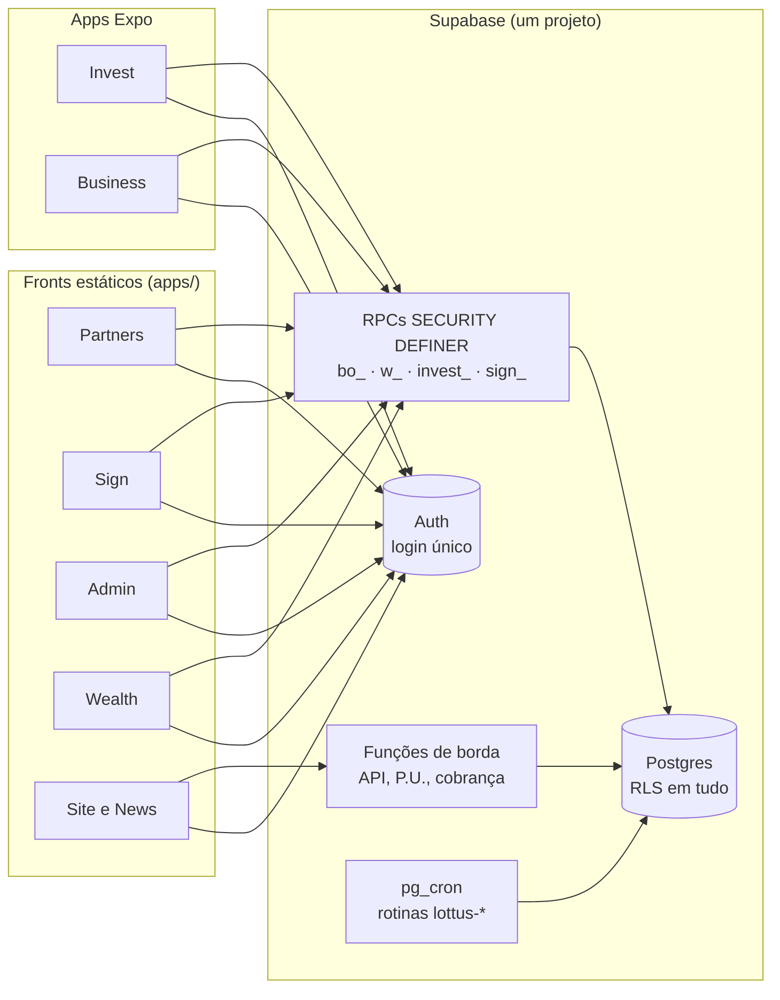

<p align="center">
  
</p>

<p align="center">
  Ecossistema de crédito e investimentos da Lottus: fundos, cedentes, investidores e assinaturas sobre um único login e um único banco.
</p>

---

## Plataformas

| Plataforma | Para quem | Onde está | Estado |
| --- | --- | --- | --- |
| **Partners** | Fundos e gestoras (FIDC, securitizadora) aprovam, pagam e acompanham operações | [`apps/partners`](apps/partners) | Beta |
| **Sign** | Quem assina e verifica documentos | [`apps/sign`](apps/sign) | Beta |
| **Admin** | Equipe da Lottus (receita, clientes, comercial, financeiro, produtos) | [`apps/admin`](apps/admin) | Beta |
| **Wealth** | Investidores e escritórios organizam patrimônio, investimentos e gastos | fora deste repositório | Beta (banco aplicado, front a trazer) |
| **Invest** | Investidores de debêntures privadas (app Expo) | fora deste repositório | Parcial |
| **Business** | Cedentes antecipam recebíveis (app) | fora deste repositório | Pausado |
| **Site** | Visitantes: institucional, termos, privacidade, desenvolvedores, pagamento e ciência de cessão | [`apps/site`](apps/site) | No ar |
| **News** | Visitantes: previsões do mercado e notícias | [`apps/news`](apps/news) | No ar |
| **API** | Parceiros integram crédito e cadastro (documentação em `apps/site/desenvolvedores.html`) | Supabase (funções de borda) | Beta |



## Stack

- **Front:** HTML, CSS e JavaScript puros, sem build. `supabase-js` servido localmente (`js/vendor`), CSP estrita em cada `_headers`.
- **Banco e back:** Supabase (Postgres 17, Auth com MFA, RLS, RPCs `SECURITY DEFINER`, funções de borda, Vault e `pg_cron`).
- **Hospedagem:** Cloudflare Pages (lê `_headers` e `_redirects`) ou Vercel (`vercel.json`).
- **Apps móveis:** Expo com React Native e expo-router (Invest e Business, fora deste repositório).

## Rodar localmente

Não há instalação. Sirva a pasta da plataforma com qualquer servidor estático:

```bash
python3 -m http.server 8080 --directory apps/partners
```

Abra `http://localhost:8080`. O front fala com o projeto Supabase configurado em `apps/<plataforma>/js/config.js`. Para testar sem tocar a produção, aponte esse arquivo para um **branch** do Supabase.

Verificações (Node 20 ou mais novo, sem dependências):

```bash
node scripts/check.mjs
```

```bash
node scripts/smoke.mjs partners
```

O primeiro confere sintaxe, links locais, CSP e segredos. O segundo abre as páginas no navegador (Playwright) de 320 a 1920 px, com a rede externa bloqueada, e aponta rolagem horizontal, cortes, erros de JS e violações de CSP.

## Variáveis de ambiente

Os fronts não usam variáveis de ambiente: só o endereço do projeto e a chave **publicável** (pública por definição) em `js/config.js`. As variáveis dos scripts locais e da CLI estão documentadas em [`.env.example`](.env.example). Segredos ficam no Vault do Supabase, nunca no repositório.

## Estrutura

```text
apps/
  admin/      Lottus Admin (backoffice)
  partners/   Lottus Partners (fundos)
  sign/       Lottus Sign (assinatura e verificação)
  site/       site institucional e páginas públicas (gerado por build.py, dev.py e legal.py)
  news/       Lottus News
supabase/
  migrations/ migrações novas, prontas e ainda não aplicadas
docs/
  manual-agente-desenvolvedor.md   o processo de desenvolvimento
  agente/                          progresso, controle por plataforma e relatórios
scripts/      verificações (check.mjs, smoke.mjs)
_revisar/     arquivos sem uso aparente, aguardando decisão
```

## Documentação

- [Manual do Agente Desenvolvedor](docs/manual-agente-desenvolvedor.md) e [`CLAUDE.md`](CLAUDE.md)
- [Progresso](docs/agente/progresso.md) · [O que depende do Yuri](docs/agente/depende-de-mim.md)
- [Como contribuir](CONTRIBUTING.md) · [Segurança](SECURITY.md)
- README de publicação de cada plataforma em `apps/<plataforma>/README.md`
