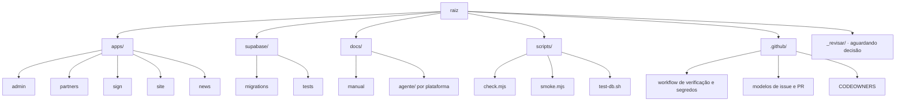

# Relatório da frente de repositório · 23/11/2026

[MAESTRO] Repositório **público** (`yurigamui/lottusfinance`). Por isso a varredura de segredos e de dados de clientes veio antes de qualquer outra coisa.

## 1. Estrutura: antes e depois

| Antes | Depois |
| --- | --- |
| `02 - Backoffice/` | `apps/admin/` |
| `03 - Site/` | `apps/site/` |
| `04 - Partners/` | `apps/partners/` |
| `05 - Sign/` (com `LEIA-ME.md`) | `apps/sign/` (com `README.md`) |
| `06 - News/` | `apps/news/` (+ `README.md`, `_headers`, `app.js`) |
| Cópia idêntica do Partners na raiz (`index.html`, `js/`, `styles.css`, `_headers`, `img/`, 4 páginas) | `_revisar/partners-copia-na-raiz/` |
| `lottus-agentes/CLAUDE.md`, `lottus-agentes/docs/` | `CLAUDE.md` e `docs/` na raiz; controle do Wealth em minúsculas (`status.md` etc.) |
| sem `.claude/agents/` (o pacote citava, mas não trazia) | 6 subagentes: idealizador, arquiteto, designer, desenvolvedor, verificador, auditor-dados |
| sem `supabase/` | `supabase/migrations/` (3 migrações novas, não aplicadas) e `supabase/tests/` |
| sem verificação | `scripts/check.mjs`, `scripts/smoke.mjs`, `scripts/test-db.sh` |

Tudo com `git mv` (histórico preservado). Nenhuma página referenciava outra pasta, então nenhum caminho interno quebrou; `check.mjs` (links locais) e `smoke.mjs` (7 larguras, CSP real) passaram depois de cada passo.

## 2. Limpeza
| O quê | Ação |
| --- | --- |
| 5 JS do Admin que nenhuma página carrega (`charts`, `settings`, `portal`, `dashboard`, `reports`, cópias antigas do Partners) | Movidos para `_revisar/admin-js-nao-carregados/` |
| `apps/partners/js/receipts.js` (não carregado) | Movido para `_revisar/partners-js-nao-carregados/` |
| Cópia do Partners na raiz | Movida para `_revisar/` (pode ser a pasta publicada hoje: ver P-02) |
| `console.log`, `debugger` | Nenhum encontrado (o `check.mjs` passa a barrar) |
| Arquivos gerados, `.DS_Store`, zips, dumps, `node_modules` | Nenhum versionado; `.gitignore` criado para impedir |
| Novos: `.gitignore`, `.editorconfig`, `package.json` (só scripts, sem dependências), `package-lock.json` | Criados |

Nada foi apagado: tudo o que parecia sem uso está em `_revisar/`, com a decisão em `depende-de-mim.md` (P-03).

## 3. Segurança: riscos por gravidade

| Gravidade | Risco | Situação |
| --- | --- | --- |
| Alta | 19 funções de borda sem `verify_jwt` ainda não lidas (API-02) | Pendente: depende do código no repo (D-02) |
| Alta | `w_spend_update`/`w_rule_save` gravavam cadastro de outra carteira (W-022) | Corrigido em migração, não aplicada |
| Alta | Injeção de HTML no Partners por nome de cedente/investidor/favorecido (5 subtítulos + confirmação de Pix) | Corrigido no front (ver `partners/relatorio.md`) |
| Alta (controle) | `legacy_gl_lines` sem RLS (sem grant, não exposta hoje) | Corrigido em migração, não aplicada |
| Média | Site sem `script-src` na CSP e com scripts inline; News sem CSP nenhuma | **Corrigido** (CSP estrita, scripts em arquivos) |
| Média | 34 funções internas `_` executáveis por `anon` via `/rest/v1/rpc` | Corrigido em migração, não aplicada |
| Média | Proteção contra senhas vazadas desligada no Supabase Auth (alerta do Supabase) | Depende do Yuri (S-02) |
| Baixa | Chave `anon` legada (JWT) no histórico do git, pasta `01 - Site` (commits de 11/08 a 31/08/2026, ex.: `76069bf`, `0f1c36d`), 12 arquivos. Tipo: chave pública de papel `anon` | Histórico não reescrito; desligar chaves legadas (S-01) |
| Baixa | Chave publicável do Supabase no front (`js/config.js`, `ciencia.js`, `news/app.js`) | Esperado: é pública por definição; liberada no `.gitleaks.toml` |
| — | `service_role`, senhas, tokens, chaves privadas, connection strings, `.env` | **Nenhum** encontrado no código atual nem no histórico (50 commits) |
| — | Dados de clientes (CPF, CNPJ de cliente, planilhas, dumps) | **Nenhum**. Só exemplos fictícios (`12.345.678/0001-90`, `maria@exemplo.com.br`), o modelo vazio da ficha de crédito e o CNPJ público da securitizadora parceira no rodapé do site |

Ferramentas criadas: `SECURITY.md`, `.github/CODEOWNERS`, workflow gratuito `.github/workflows/seguranca.yml` (sintaxe/links/CSP/segredos com `check.mjs`, `npm audit`, migrações em Postgres local e Gitleaks no histórico completo), `.gitleaks.toml`, `.env.example` documentado. `npm audit`: 0 vulnerabilidades (o repositório não tem dependências npm; as bibliotecas de `vendor/` são `supabase-js` 2.45.4, `pdf-lib`, `lenis` e `qrcode`, sem vulnerabilidade conhecida registrada aqui).

Não rodado localmente: o binário do Gitleaks (o download foi bloqueado pela política desta sessão); roda no CI a cada push. A varredura local foi feita com `git grep` em todos os commits.

## 4. Apresentação
`README.md` com propósito, mapa das 8 frentes, diagrama Mermaid, stack, como rodar, variáveis, estrutura e links; README curto em cada `apps/<plataforma>`; `CONTRIBUTING.md`; modelos de issue (defeito, melhoria) e de pull request; padrão de commit `plataforma/seção: o que mudou`. Sem `LICENSE` (G-02). Descrição, tópicos e imagem social prontos em `depende-de-mim.md` (G-01).

## 5. O que depende do Yuri
P-01 (apontar a hospedagem para as pastas novas **antes** do merge), P-02, P-03, G-01 a G-03, configurações do GitHub (seção 3 de `depende-de-mim.md`), S-01, S-02, D-01, D-02.
